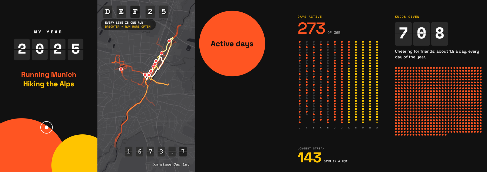
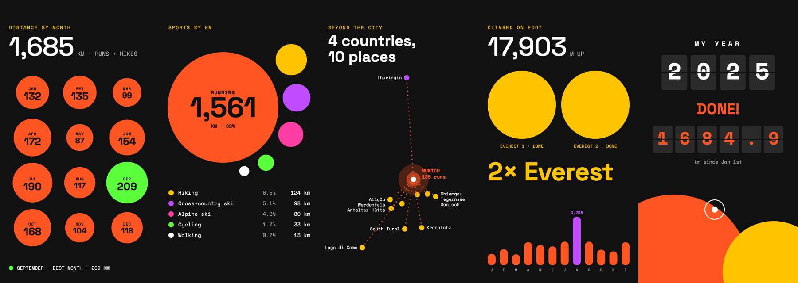
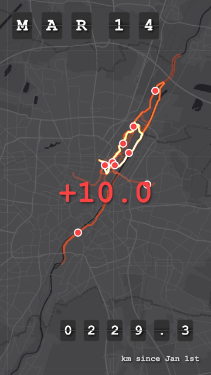
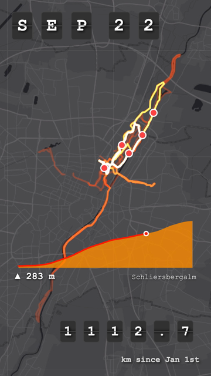

# Strava Runner Animation

Turns a **Strava bulk export** (GPX files) into a two-minute film of your year: every run is drawn on the city map, then 15 stat screens follow, joined by transitions in which a dot or ring of one screen becomes the main shape of the next. `npm run record` renders it as a 1080×1920 MP4, `npm run sound` adds music, sound effects and an announcer. Works on phones.

The Strava REST API is not used: everything is read from the export folder on disk.




*Frames of the film for 2025 (runs in Munich, hikes in the Alps). The screens with personal photos are not shown here.*

▶️ **An earlier version without the stat screens:** [My Year 2025 on YouTube](https://youtube.com/shorts/u-xGleFsDeQ)

## Features

- 🏃‍♂️ City tracks: several runs are drawn at once, and streets you run often glow brighter, from red to yellow to white
- 🎞️ Stat screens: most-run spot, start hours, fastest and longest run, active days, kudos, km per month, sports, places, highest point, most climb, total climb, a numbered hike series, coldest and hottest day, last run
- 💬 Before each screen, the shape that arrives swells into a bubble with the screen's title ("Active days") and shrinks back
- 🔢 Counters start close to their final value instead of at zero, so they do not pull the eye away
- 📅 Airport-style split-flap boards for the date and the km since Jan 1st
- 🎥 `npm run record`: 1080×1920 MP4 for Instagram stories and YouTube Shorts
- 🔊 `npm run sound`: your music, generated sound effects and announcer lines, all placed from `config.json`
- No database, no login

## Quick start

### 1. Put your files in place

| What | Where | In git? |
| --- | --- | --- |
| Strava export (unzipped) | `strava-export/` | no (`.gitignore`) |
| Photos for the stat screens | `film-photos/` | no |
| Soundtrack (MP3) | `sound-assets/soundtrack.mp3` | no |
| ElevenLabs API key | `.env` | no |
| Texts, places, timing, sound cues | `config.json` | yes |

**Strava export:** Strava → *Settings → My Account → Download or Delete Your Account → Request your archive*. Unzip it into `strava-export/` (or set `STRAVA_EXPORT_DIR` in `.env` to where it is). The film reads:

```
strava-export/
├── activities.csv          # activity type, date, distance, file name
├── reactions.csv           # kudos you gave (optional; without it the kudos screen is left out)
└── activities/
    ├── 123456789.gpx
    └── 987654321.gpx.gz    # gzipped GPX is read too; .fit/.tcx are skipped
```

German and English exports both work (`Aktivitätsart`/`Activity Type`, …).

**Photos:** copy up to eight JPGs into `film-photos/` and name them in `config.json` under `film.photos`, one per screen:

```json
"photos": {
  "fastest":  { "file": "race.jpg", "focus": 0.55 },
  "longest":  { "file": "long-run.jpg" },
  "highest":  { "file": "summit.jpg" },
  "hilliest": { "file": "climb.jpg" },
  "series":   { "file": "series.jpg" },
  "coldest":  { "file": "winter.jpg" },
  "hottest":  { "file": "summer.jpg" },
  "lastRun":  { "file": "last-run.jpg" }
}
```

`focus` (0..1) is the vertical position of what matters in the picture. A screen without a photo shows an empty circle.

**Soundtrack and API key** are only needed for `npm run sound`, see [Add sound](#add-sound).

### 2. Make it your year

`config.json` ships with the author's year. Change at least:

- `animation.startDate` / `endDate` and `animation.centerLat` / `centerLng` / `radiusMeters` (your city)
- `data.activityTypes` (`Lauf` in a German export, `Run` in an English one)
- `intro.lines`, `film.places`, `film.series`, `film.coldest` / `hottest` (the export has no place names and no weather)
- `sound.cues`: the announcer's lines (`say`) name the author's numbers

#### Or let an AI coding assistant do it

Open the repository in Claude Code (or a similar assistant) and prompt:

> My Strava export is in `~/Downloads/export_12345678` and my photos are in `~/Pictures/year-2025`.
> Set up this project for my year 2025 in Hamburg: copy the export to `strava-export/` and the photos to `film-photos/`,
> then adapt `config.json`: dates, city center and radius, activity types of my export, `film.places` from where my
> hikes were, `film.photos` with the photo that fits each screen, and the announcer lines in `sound.cues` with my
> numbers from `GET /api/film`. Start the server and show me a still frame of every screen.

### 3. Run

```bash
npm install
cp .env.example .env
npm run dev        # or: npm run build && npm start
# open http://localhost:3000
```

The film starts automatically. `?film=0` plays only the city tracks, with hikes as elevation profiles:

| Runs | Hike |
| --- | --- |
|  |  |

### 4. Record a video

```bash
npm run record
# -> recordings/running-2025.mp4  (1080x1920 portrait, H.264, 30 fps, about 2 minutes)
```

The script starts its own server, opens the app in headless Google Chrome (360x640 at 3x
pixel density) and renders it frame by frame with a virtual clock. Timers, animation frames
and CSS transitions only advance one video frame at a time, so the video is smooth and
the same on every run, however long each screenshot takes.
Needs Google Chrome and `ffmpeg` (`brew install ffmpeg`).

Options (after `--`):

| Option | Default | Effect |
| --- | --- | --- |
| `--fps` | `30` | frame rate |
| `--out` | `recordings/running-<year>.mp4` | output file |
| `--hold` | `4` | seconds the end screen stays |
| `--params` | | URL parameters, e.g. `--params "interval=0.3&intro=0"` |
| `--port` | `3999` | port of the temporary server |

### 5. Add sound

<a id="add-sound"></a>

```bash
npm run sound
# recordings/running-2025.mp4 -> recordings/running-2025-sound.mp4
npm run sound -- --dry-run     # prints the cue sheet and the ffmpeg call, generates nothing
```

Two personal things are needed, and neither is ever committed:

1. **A soundtrack:** copy an MP3 to `sound-assets/soundtrack.mp3` (the path is `sound.music.file`), or upload it:
   ```bash
   curl -X PUT -H "Content-Type: audio/mpeg" --data-binary @my-song.mp3 http://localhost:3000/api/sound/music
   ```
   Without a soundtrack the film is mixed with effects and voice only. Music shorter than the film starts again.
2. **An [ElevenLabs](https://elevenlabs.io) API key** for the effects and the announcer: write `ELEVENLABS_API_KEY=...` into `.env`, or:
   ```bash
   curl -X PUT -H "Content-Type: application/json" -d '{"apiKey":"..."}' http://localhost:3000/api/sound/elevenlabs-key
   ```
   The key is written to `.env` (readable by you only) and is never returned by the API.

`npm run record` writes `<video>.timeline.json` next to the video: where every screen, title bubble and
transition starts. `npm run sound` places the cues of `config.json` (`sound.cues`) on it, generates the
effects and lines that are not in `sound.assetDir` yet, and mixes everything under the video with one
ffmpeg call. A sound is only generated (and paid for) again when its description or line changes.

Options (after `--`): `--video <file>`, `--out <file>`, `--dry-run`.

## Configuration (`config.json`)

### Data, city tracks, map

| Key | Meaning |
| --- | --- |
| `data.exportDir` | Export folder, used when `STRAVA_EXPORT_DIR` is not set |
| `data.activityTypes` | Values of the activity type column to include (`Lauf` in a German export, `Run` in an English one) |
| `data.hikeActivityTypes` | Hikes (`Wandern` / `Hike`); not limited to the area |
| `data.countedActivityTypes` | Added up in the km counter, wherever they happened (default: runs and hikes) |
| `data.hikeProfileSamples` | Points of the abstract elevation profile |
| `data.minPointSpacingMeters` | GPX points closer than this are dropped (keeps the payload small) |
| `animation.startDate` / `endDate` | Date range, both inclusive |
| `animation.centerLat` / `centerLng` / `radiusMeters` | Only runs **starting** inside this circle are shown |
| `animation.runStartIntervalSeconds`, `secondsPerKm`, `minRunSeconds`, `hikeSeconds` | Pace of the city tracks without the film (`?film=0`) |
| `animation.routeColor` / `routeWeight` / `routeOpacity` | Style of a single route |
| `animation.routeBlend` | `additive` (overlaps get brighter) or `normal` (plain alpha blending) |
| `intro.kicker` / `intro.lines` / `intro.seconds` | Title screen ("My year / 2025 / Running Munich / Hiking the Alps"); the year comes from `startDate` |
| `finale.title` | Shown above the final km ("DONE!") |
| `map.tileUrl` / `tileAttribution` / `tileMaxZoom` | Base map. CARTO's `dark_all` now needs an API key, so the default is Esri's keyless *World Dark Gray Base* |

### The film (`film`)

| Key | Meaning |
| --- | --- |
| `film.timeZone` | Time zone for start hours, days and months |
| `film.citySeconds` | Length of the city tracks in the film (run speed and interval follow from it) |
| `film.sceneSeconds` / `holdSeconds` | Length of every stat screen, and how long the finished screen stands still at its end |
| `film.titles` / `titleSeconds` | Title bubble per screen, by screen id (`city`, `hotspot`, `earlyBird`, `fastest`, `longest`, `days`, `kudos`, `months`, `sports`, `alps`, `highest`, `hilliest`, `everest`, `series`, `coldest`, `lastRun`, `finale`), and how long it shows. A screen without an entry gets no bubble; a title without letters (`👍`) is drawn as a big icon |
| `film.counterStartShare` | Counters start this share of their value away from it (0.15: 1,700 → 2,000) |
| `film.hotspotMinMetersFromStart` | The most-run spot ignores this many meters around every run's start and end, so it is not your front door |
| `film.sportNames` | Activity type of the export → name on screen |
| `film.elevationExcludedTypes` | Activity types whose climb does not count (lifts) |
| `film.series` | A numbered series of activities: label, caption, keywords in the activity name, keyword of the highlighted one |
| `film.places` / `placesHeadline` | Pins and headline of the "beyond the city" screen |
| `film.coldest` / `hottest` | Name, date and temperature of the coldest and hottest activity (`null` leaves the screen or the hot end out) |
| `film.texts` | Sentences with placeholders: `hotspot` (`{count}`, `{of}`), `kudos` (`{perDay}`) |
| `film.photoDir` / `photos` | Folder with your photos and which file belongs to which screen |

A screen without data (no `reactions.csv`, no series, no `coldest`) is left out, with its bubble and transitions.
The film takes about `intro.seconds + citySeconds + 15 × (sceneSeconds + titleSeconds) + 15 s`.

### Sound (`sound`)

| Key | Meaning |
| --- | --- |
| `sound.music` | Music file (empty = none), where to start in it, level in dB, fade-out, and how it gives way under the announcer (`duck`) |
| `sound.voice` | ElevenLabs voice id and model, a style tag put in front of every line (`[excited]`), level |
| `sound.effects` | Effects by name: `prompt` (description for the generator), `seconds`, `gainDb` |
| `sound.cues` | One line per sound: `at`, `offset` in seconds, `effect` or `say`, optional `gainDb` and `repeat` (`count`, `everySeconds`). `at` is a screen id, `from>to` for a transition, `intro:<id>` for a title bubble, `city`, or `transition` / `intro` for every transition / bubble without its own cue |
| `sound.targetLufs` | Loudness of the finished mix (−14 is what YouTube plays at) |

### URL parameters

They override `config.json` for quick experiments:

| Parameter | Example | Effect |
| --- | --- | --- |
| `film` | `?film=0` | only the city tracks with hike profiles, without the stat screens |
| `interval` | `?interval=0.5` | `runStartIntervalSeconds` |
| `secondsPerKm`, `minRunSeconds` | `?secondsPerKm=0.3` | run duration |
| `hikeSeconds` | `?hikeSeconds=2` | hike profile duration |
| `opacity`, `weight`, `color` | `?opacity=0.2&color=33aaff` | route style |
| `blend` | `?blend=normal` | `routeBlend` |
| `autoplay` | `?autoplay=0` | do not start automatically |
| `intro` | `?intro=0` | skip the title screen |
| `controls` | `?controls=1` | show the burger menu (start / show all routes / clear) and zoom buttons |

## API

- `GET /api/activities`: runs in the configured period and area, sorted by date, with coordinates
- `GET /api/hikes`: hikes in the configured period with elevation profile and gain
- `GET /api/summary`: how many activities were read, filtered and loaded, and `totalKm`
- `GET /api/film`: the numbers of the film's stat screens
- `POST /api/activities/reload`: re-read the export after changing files
- `GET /api/config`: animation, film and map settings
- `GET /api/sound`: is there a soundtrack, is there an ElevenLabs key (never the key itself)
- `PUT /api/sound/music`: store the request body (an MP3, `Content-Type: audio/mpeg`, up to 60 MB) as the soundtrack
- `PUT /api/sound/elevenlabs-key`: store `{ "apiKey": "..." }` in `.env`

The two `PUT` routes write to disk, so they only answer requests from the computer the server runs on. Errors are JSON `{ "error": "..." }` with status 400 (not an MP3, unusable key), 403, 413 or 500.
The export is parsed on the first request (about 0.5 s for a year of runs) and kept in memory.

## Docker

```bash
STRAVA_EXPORT_DIR=/path/to/export_12345678 docker compose up -d --build
```

The export folder is mounted read-only into the container.

## Project structure

```
├── src/                          # Node / TypeScript
│   ├── server.ts                 # Express: static files + /api
│   ├── config.ts                 # config.json + .env
│   ├── types.ts                  # config and API types
│   ├── geo.ts                    # haversine distance
│   ├── export/
│   │   ├── ExportStore.ts        # the parsed export, kept until reload
│   │   ├── exportLoader.ts       # runs (area filter) + hikes + km counter
│   │   ├── csv.ts, gpx.ts        # activities.csv / reactions.csv, GPX track points
│   │   ├── elevationProfile.ts, kmCounter.ts
│   │   └── filmStats.ts          # numbers of the film (GET /api/film)
│   ├── record/
│   │   ├── record.ts             # npm run record: headless Chrome -> frames -> MP4 + timeline
│   │   ├── virtualClock.ts       # page clock that only moves one frame per step
│   │   └── videoEncoder.ts       # ffmpeg (H.264, yuv420p)
│   └── sound/
│       ├── sound.ts              # npm run sound (SoundTrack): cues -> missing sounds -> mix
│       ├── SoundTimeline.ts      # film timeline of a recording, cues placed on it
│       ├── SoundAssets.ts        # generated sounds, named after what they were made from
│       ├── ElevenLabs.ts         # sound effect and speech calls
│       ├── SoundMixer.ts         # the ffmpeg call (music, ducking, effects, voice)
│       ├── SoundSettings.ts      # soundtrack file and API key on disk
│       └── SoundApi.ts           # /api/sound
├── public/                       # Browser / Vue 3 + Leaflet, no build step
│   ├── index.html
│   ├── css/                      # one file per component, shared tokens in base.css
│   └── js/
│       ├── main.js, App.js       # app phases: loading -> intro -> playing -> stats -> finale
│       ├── map/                  # MapView (two additive canvases), BlendingCanvas
│       ├── animation/            # city tracks: Timeline, RunAnimation, HikeQueue, schedule
│       ├── film/
│       │   ├── Film.js           # the film: scenes -> segments (scene, transition, title bubble)
│       │   ├── FilmData.js       # what the scenes read: stats, config, counters
│       │   ├── Scene.js          # base class: frame(t, d), enter(d), exit(d)
│       │   ├── scenes/           # the 18 scenes in three acts: munich.js, dots.js, mountains.js
│       │   ├── Transition.js     # how one scene's shape becomes the next one's
│       │   ├── TitleBubble.js    # the bubble that announces a scene
│       │   ├── Hill.js           # elevation profile with the dot walking up
│       │   ├── Painter.js        # draws a frame on the canvas
│       │   ├── FilmPlayer.js     # plays a part of the film
│       │   └── items.js, ease.js # drawable items, easing and counters
│       └── components/           # SplitFlap, FlapBoard, DateBoard, DistanceBoard, HikeProfile, …
├── test/frontend/                # tests for the browser modules
└── config.json
```

Every scene is a class whose `frame(t, d)` returns what to draw at time `t` (0..1), so a
frame of the film is a pure function of time: `film.frameAt("stats", ms)`.

### Tests

```bash
npm test   # node:test: export parsing, film stats, every scene and transition, sound timeline, mixer, settings
```

## Troubleshooting

**"No runs found for the configured period and area"**: check `GET /api/summary`. Of `runsInPeriod`, `outsideArea` counts runs starting outside the circle, `noGpsFile` treadmill and manual runs without GPS, `unsupportedFile` tracks in another format than GPX.

**Wrong activity type**: open `activities.csv` and copy the exact value of the activity type column into `data.activityTypes`.

**A photo does not show**: the browser console says `Film photo not found: <file>`; the name in `film.photos` must match the file in `film-photos/`.

**`npm run sound` says sounds are missing**: set the ElevenLabs key (see [Add sound](#add-sound)); `--dry-run` lists what would be generated.
