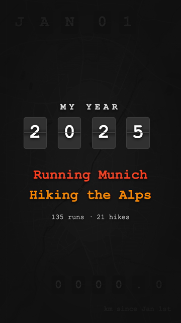
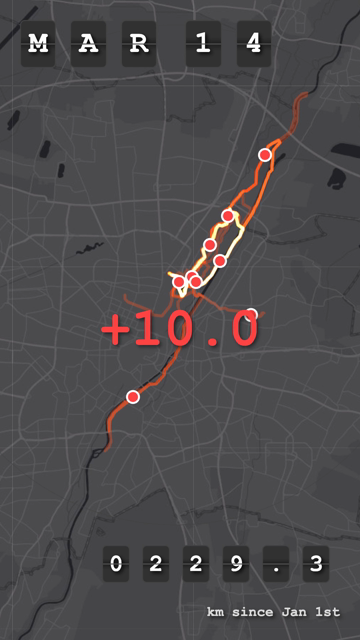
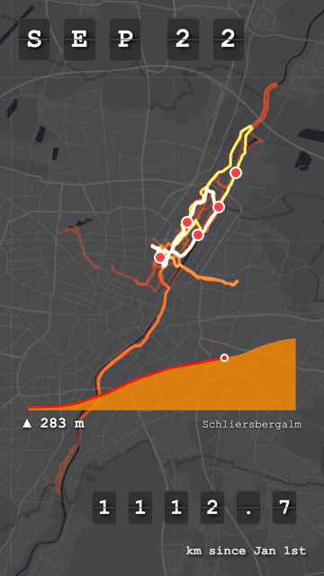
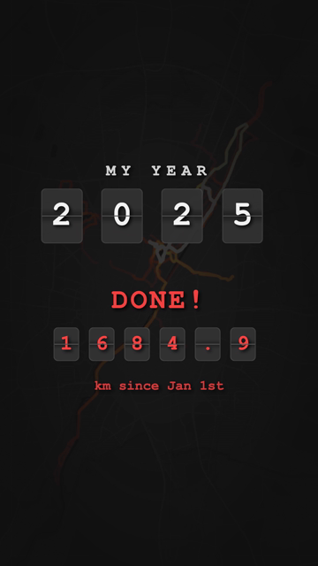

# Strava Runner Animation

Animates a year of running routes from a **Strava bulk export** (GPX files). Each run is drawn by a runner dot, a new run starts every 0.5 seconds, and streets you run often glow brighter, from red to yellow to white. Hikes appear as an abstract elevation profile with a red line running across it. Split-flap boards show the date and the km since Jan 1st (runs and hikes). Works on phones.

The Strava REST API is no longer used: everything is read from the export folder on disk.

| Title card | Runs | Hike | Finale |
| --- | --- | --- | --- |
|  |  |  |  |

*Frames from `npm run record` (all 2025 runs in Munich and hikes in the Alps).*

▶️ **Watch the full video:** [My Year 2025 on YouTube](https://youtube.com/shorts/u-xGleFsDeQ)

## Features

- 🏃‍♂️ Several runs at once: run *n+1* starts `runStartIntervalSeconds` after run *n*, it does not wait for it to finish
- 🔥 Additive route blending: overlapping routes add up light instead of saturating at one color
- 📅 Airport-style flipping date display
- ⛰️ Hikes: orange elevation profile (80% opacity) in the lower part of the screen, a red line runs over it from left to right; elevation gain and name below
- 📊 Cumulative distance of all runs and hikes of the year (Strava's own distance from `activities.csv`), also those not drawn on the map
- 🎬 Title card ("My year 2025 / Running Munich / Hiking the Alps") and a finale with the year, "DONE!" and the total km
- 🎥 `npm run record` renders the animation as a 1080×1920 MP4 for Instagram stories
- 📱 Map zooms to fit all routes; boards scale with the screen width
- 🗺️ Dark map with a configurable center point and radius
- No database, no login

## Setup

### 1. Get your Strava export

Strava → *Settings → My Account → Download or Delete Your Account → Request your archive*. Unzip it. The folder must contain:

```
export_12345678/
├── activities.csv          # activity type, date, distance, file name
└── activities/
    ├── 123456789.gpx
    └── 987654321.gpx.gz    # gzipped GPX is read too; .fit/.tcx are skipped
```

German and English exports both work (`Aktivitätsart`/`Activity Type`, …).

### 2. Configure

```bash
cp .env.example .env
# set STRAVA_EXPORT_DIR=/path/to/export_12345678
```

`config.json`:

| Key | Meaning |
| --- | --- |
| `data.exportDir` | Export folder, used when `STRAVA_EXPORT_DIR` is not set |
| `data.activityTypes` | Values of the activity type column to include (`Lauf` in a German export, `Run` in an English one) |
| `data.hikeActivityTypes` | Shown as elevation profile instead of on the map (`Wandern` / `Hike`); not limited to the area |
| `data.countedActivityTypes` | Added up in the km counter, wherever they happened (default: runs and hikes; add `Spaziergang` / `Walk` for walks) |
| `data.hikeProfileSamples` | Points of the abstract elevation profile |
| `data.minPointSpacingMeters` | GPX points closer than this are dropped (keeps the payload small) |
| `animation.startDate` / `endDate` | Date range, both inclusive |
| `animation.centerLat` / `centerLng` / `radiusMeters` | Only runs **starting** inside this circle are shown |
| `animation.runStartIntervalSeconds` | Delay between the start of two consecutive runs or hikes (default 0.5) |
| `animation.hikeSeconds` | How long a hike profile is shown (shorter when the next hike is already due) |
| `animation.secondsPerKm` / `minRunSeconds` | How long one run takes to draw: `max(minRunSeconds, km × secondsPerKm)` |
| `animation.routeColor` / `routeWeight` / `routeOpacity` | Style of a single route |
| `animation.routeBlend` | `additive` (overlaps get brighter) or `normal` (plain alpha blending) |
| `intro.kicker` / `intro.lines` / `intro.seconds` | Title card before the animation ("My year / 2025 / Running Munich / Hiking the Alps"); the year comes from `startDate`, `seconds: 0` turns it off |
| `finale.title` | Shown above the final km ("DONE!") |
| `map.tileUrl` / `tileAttribution` / `tileMaxZoom` | Base map. CARTO's `dark_all` now needs an API key, so the default is Esri's keyless *World Dark Gray Base* |

Total length ≈ `(runs + hikes) × runStartIntervalSeconds` + the duration of the last run, e.g. 135 runs + 21 hikes → about 83 seconds.

### 3. Run

```bash
npm install
npm run dev        # or: npm run build && npm start
# open http://localhost:3000
```

The animation starts automatically.

#### URL parameters

They override `config.json` for quick experiments:

| Parameter | Example | Effect |
| --- | --- | --- |
| `interval` | `?interval=0.5` | `runStartIntervalSeconds` |
| `secondsPerKm`, `minRunSeconds` | `?secondsPerKm=0.3` | run duration |
| `hikeSeconds` | `?hikeSeconds=2` | hike profile duration |
| `opacity`, `weight`, `color` | `?opacity=0.2&color=33aaff` | route style |
| `blend` | `?blend=normal` | `routeBlend` |
| `autoplay` | `?autoplay=0` | do not start automatically |
| `intro` | `?intro=0` | skip the title card |
| `controls` | `?controls=1` | show the burger menu (start / show all routes / clear) and zoom buttons |

#### Record a video

```bash
npm run record
# -> recordings/running-2025.mp4  (1080x1920 portrait, H.264, 30 fps, ~90 s, ~13 MB)
```

The script starts its own server, opens the app in headless Google Chrome (360x640 at 3x
pixel density) and renders it frame by frame with a virtual clock. Timers, animation frames
and CSS transitions only advance one video frame at a time, so the video is smooth and
the same on every run, however long each screenshot takes (about 2.5 minutes for a year).
Needs Google Chrome and `ffmpeg` (`brew install ffmpeg`).

Options (after `--`):

| Option | Default | Effect |
| --- | --- | --- |
| `--fps` | `30` | frame rate |
| `--out` | `recordings/running-<year>.mp4` | output file |
| `--hold` | `4` | seconds the finale stays at the end |
| `--params` | | URL parameters, e.g. `--params "interval=0.3&intro=0"` |
| `--port` | `3999` | port of the temporary server |

#### Docker

```bash
STRAVA_EXPORT_DIR=/path/to/export_12345678 docker compose up -d --build
```

The export folder is mounted read-only into the container.

## API

- `GET /api/activities`: runs in the configured period and area, sorted by date, with coordinates
- `GET /api/hikes`: hikes in the configured period with elevation profile and gain
- `GET /api/summary`: how many activities were read, filtered and loaded, and `totalKm`
- `POST /api/activities/reload`: re-read the export after changing files
- `GET /api/config`: animation and map settings

The export is parsed on the first request (about 0.5 s for a year of runs) and kept in memory.

## Project structure

```
├── src/                          # Node / TypeScript
│   ├── server.ts                 # Express: static files + /api
│   ├── config.ts                 # config.json + STRAVA_EXPORT_DIR
│   ├── types.ts                  # config and API types
│   ├── geo.ts                    # haversine distance
│   ├── export/
│   │   ├── exportLoader.ts       # runs (area filter) + hikes + km counter
│   │   ├── csv.ts                # activities.csv (de/en column names)
│   │   ├── gpx.ts                # GPX / GPX.gz track points, thinning, elevations
│   │   ├── elevationProfile.ts   # abstract hike profile, elevation gain
│   │   └── kmCounter.ts          # "km since Jan 1st" for any date
│   └── record/
│       ├── record.ts             # npm run record: headless Chrome -> frames -> MP4
│       ├── virtualClock.ts       # page clock that only moves one frame per step
│       └── videoEncoder.ts       # ffmpeg (H.264, yuv420p)
├── public/                       # Browser / Vue 3 + Leaflet, no build step
│   ├── index.html
│   ├── css/                      # one file per component, shared tokens in base.css
│   └── js/
│       ├── main.js, App.js       # app phases: loading -> intro -> countdown -> playing -> finale
│       ├── api.js, urlOptions.js
│       ├── map/                  # MapView (two additive canvases), BlendingCanvas
│       ├── animation/            # Timeline, RunAnimation, HikeQueue, schedule, geometry
│       └── components/           # SplitFlap, FlapBoard, DateBoard, DistanceBoard, YearTitle,
│                                 # IntroCard, HikeProfile, DistancePopup, ControlsMenu
├── test/frontend/                # tests for the browser modules
└── config.json
```

### Tests

```bash
npm test   # node:test, for CSV/GPX parsing, elevation profile, km counter, schedule, hike queue, geometry
```

## Troubleshooting

**"No runs found for the configured period and area"**: check `GET /api/summary`. Of `runsInPeriod`, `outsideArea` counts runs starting outside the circle, `noGpsFile` treadmill and manual runs without GPS, `unsupportedFile` tracks in another format than GPX.

**Wrong activity type**: open `activities.csv` and copy the exact value of the activity type column into `data.activityTypes`.
